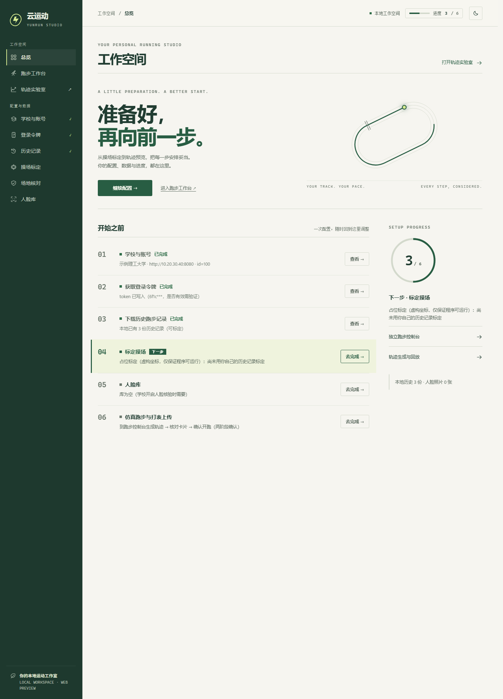
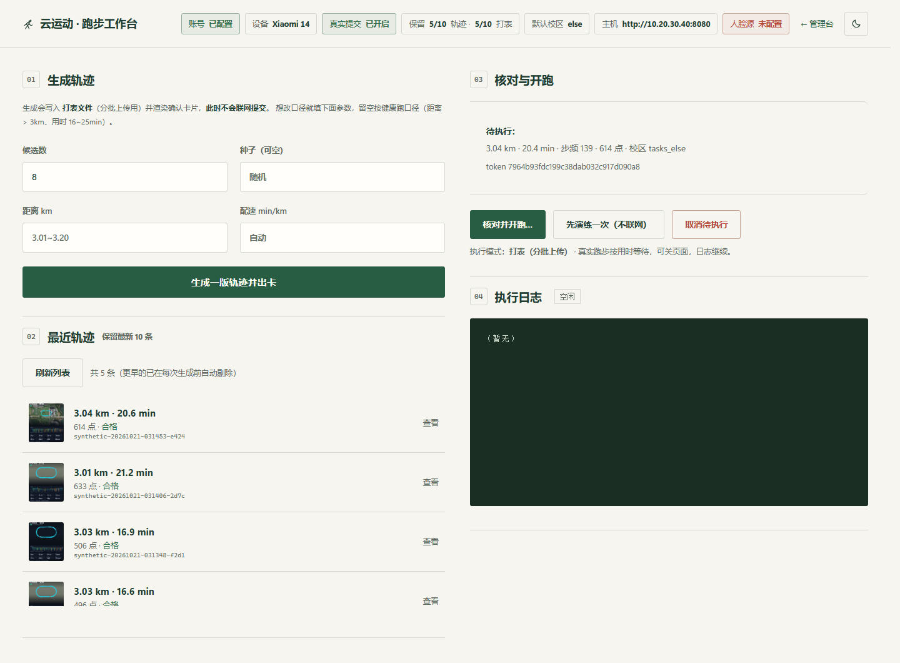
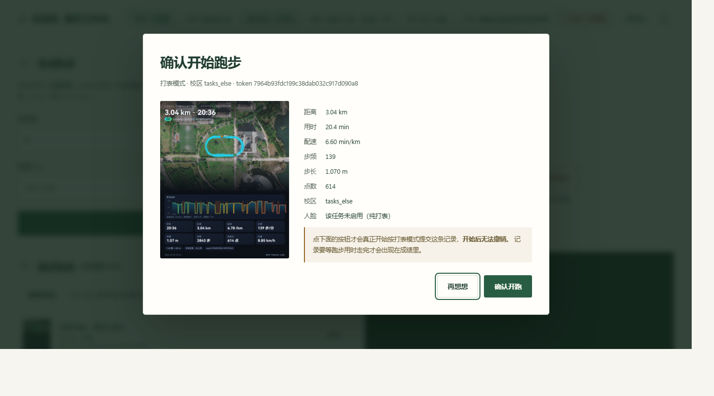
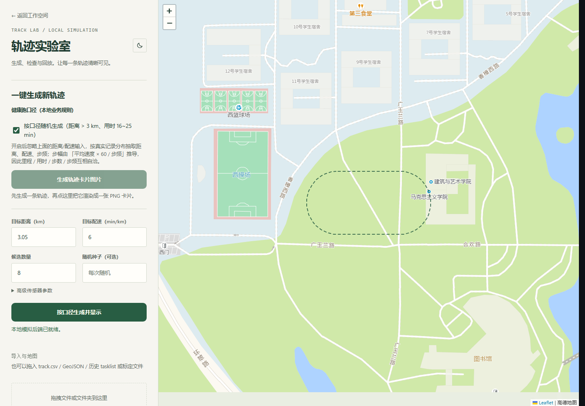
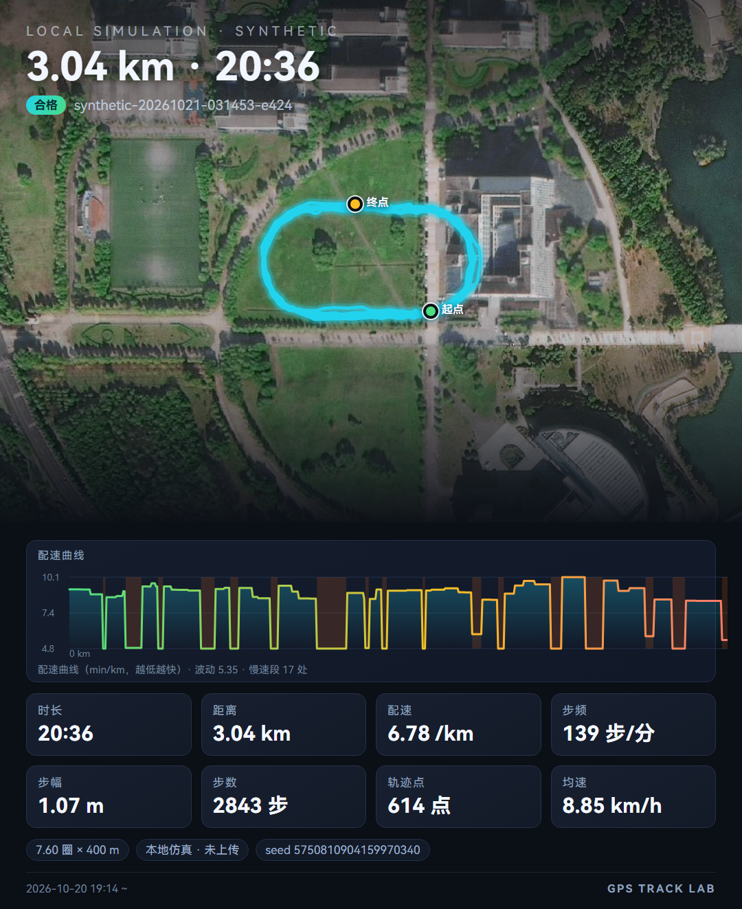

# 云运动 yunForNewVersion

> 这是我在 [Zirconium233/yunForNewVersion](https://github.com/Zirconium233/yunForNewVersion) 上改动的自用版
> 我在它上面加了点新功能，详细的清单在下一节，其中使用方法、遇到过的问题，详细内容写在 [README.fork.md](README.fork.md)
>
> - **使用前请确保自己了解使用风险** 服务器现在会检查重复轨迹，可能还有人审。我看到 issue 中存在成绩跑出来合格、过一两天被标作弊的情况，因此在使用本项目前请清楚使用风险
> - 本项目适用于云运动的 3.6.6 版本，我自己已经用了大半个学期了，期间学校开过两天人脸也没有出现作弊的判定。3.6.7 的两处差异（人脸字段、`manageList` 的 index）我这套也跟上了，但只在离线测试里验过，细节在 [README.fork.md](README.fork.md)
> - 根目录那份 `config.ini` 是原项目带的样例，里面已经存有样例的学校地址了，
>   你要用的是 `yunrun/config.ini`，从 `yunrun/config.example.ini` 复制


## 新增的功能

我把这原先项目配置链路包成了一个能点着用的本地工具

**1. 网页前台** 起个本地服务就有三个页面：`/admin` 是引导页，学校 → 令牌 → 历史 → 标定 →
人脸 → 跑步，跟着我的引导将配置走完就好，
完成后生成一版轨迹再出张卡片看一眼，或者直接在 `轨迹实验室` 里看下操场的标定和轨迹位置是否正确，前往工作台生成轨迹后核对并确认开跑

**2. 手机端 token 抓取** 云运动暑假更新后收紧了 HTTPS 证书校验，因此做了个直接从手机日志抓取 token 的小脚本，先配置好 adb 环境然后在控制台网页 → 登录令牌 → 从手机拉取令牌即可，
或双击 `pull_token.bat`（Mac 上是 `pull_token.command`）：连手机 →
重启云运动 → 自动点开「我的」页触发一次请求 → 从 logcat 里把最新的 token 捞出来 → 写回 config.ini →
再拿只读接口验一下。**全程不碰登录接口**，手机上那边的会话不会掉
脚本在 `yunrun/refresh_token_adb.py`

**3. 操场标定** 拿自己的历史记录反推跑道长什么样：假设跑道是「两条直道 + 两个半圆」的体育场形状，
把点云用 PCA 定向、按分位量尺幅，拟出中心、朝向、半径、圈长四个参数
另配了个「换一批历史重新标定」的小工具，我在上学期使用脚本时遇到过很多次跑步记录都挂错场的情况，虽然算到目前还是合格没人查，但是记录里还留着场地和地图对不上号的情况。任务号换学期时可能变，
所以选任务只看几何：打卡点围栏能包住标定中心的那一个才算，不认列表顺序

**4. 跑步仿真** 思路是「先定速度形状、其余全派生」：先铺出一串跑段和走段（走段数量、位置、配速、
时长各自抽），步频再从观测区间里抽、步幅由速度和步频反算，所以步数/步频/配速三者不可能互相矛盾；
然后沿着标定好的跑道每 2 秒吐一个点，叠上横向偏移、GPS 噪声和偶发丢点。生成窗口压在
3.01–3.20 km、16–25 分钟，一次出 8 个候选按物理质量打分挑一个

**5. 卡片渲染** 把一版轨迹画成一张图：卫星底图 + 轨迹线 + 配速曲线 + 关键指标，
用本机 Edge / Chrome 的无头模式截图。**这是提交前最后一道人工核对**——
卡片出来，你确认一下仿真的配速曲线还有轨迹是否落在操场后再确认开跑

剩下三块顺带说一下。人脸库能存好几张照片、拿 RetinaFace 自动挑、取景不合格会直接告诉你哪儿不合格
生成的一次跑步任务一次性令牌只活 30 分钟、确认位、`allow_submit` 开关——只写在 `mcp_bridge.py` 一处，没散在别的地方
提交跑在独立进程里（`scripts/run_worker.py`），网页关掉不中断，中止停在两批之间，不会给你留一条半截成绩。
想接机器人或 MCP，接口是 `mcp_bridge.YunLocalBridge`，怎么接看 `yunrun/docs/INTEGRATION.md`，我自己是接给 astrbot 让她给我跑了半个学期了

标定和仿真这两块的算法设计在 [README.fork.md](README.fork.md) 的「标定和仿真的算法」里，需要的自己看

## 界面

管理前台 `/admin`，六步引导，做完一步亮一步：



跑步工作台 `/ui`，生成轨迹、看卡片、确认才提交：



点「核对并开跑」之后的确认弹窗——卡片和指标全在眼前，才允许点「确认开跑」：



轨迹实验室 `/`，在地图上核对标定和轨迹位置：



提交前要过目的那张卡片（卫星底图 + 轨迹 + 配速曲线 + 关键指标）：



## 怎么跑

先确认这几样

- Python 3.10 及以上
- 系统 adb 环境已配置、手机开着 USB 调试、云运动保持登录
- 本机装了 Edge 或 Chrome，这里只是渲染卡片需要用
  而确认前必须看卡片，所以等于跑不了（只生成轨迹的话不用它）
- 人脸检测模型已经随仓库带了（`yunrun/models/retinaface_mv1_0.25.onnx`，1.7 MB），不用自己找；
  `numpy`、`onnxruntime`、`pillow` 只有人脸与卡片功能要用，你不用可以不装

Windows：

```powershell
cd yunrun
copy config.example.ini config.ini      # 先有这份，网页才有地方写配置
pip install -r requirements.txt         # 是 yunrun/ 下这份，不是根目录那份
cd gps_track_lab
.\start_admin.bat                       # 打开 http://127.0.0.1:8437/admin
```

Mac / Linux 在仓库根目录：

```bash
cp yunrun/config.example.ini yunrun/config.ini
python3 launcher.py
```

加 `--no-browser` 不自动开浏览器，Mac 上可以直接双击根目录的 `run.command`，它会自己找个能用的 python3、在项目里建 `.venv-mac/` 把依赖装上（第一次要联网）；`./run.command --check` 只体检不启动。

`yunrun/docs/` 里那几份讲的是 runner 那一层（架构与协议、命令行用法、外部接入、概念澄清）；
新加的 Web 和业务层没单独写架构文档，看 README.fork.md 的目录树和各模块开头的注释更快。

---

### Master分支为3.4.8版本对策，对3.6.6无效。如有需要请切换到develop使用。

**注意：develop实现只经过和客户端逻辑的严格比对，未经过充分测试**

10月8日更新：

基本上都是易用性更新，现在可以快速方便的使用现有偏移算法了。

  界面演示（`python web.py`）：

  <p align="center">
    <br>
    <em>②路线预览：灰虚线＝参考原轨迹，蓝实线＝即将发送的合成轨迹，旁边即③要执行的命令</em>
  </p>

  <p align="center">
    <br>
    <em>同一来源换随机种子：形状明显不同（deform 几何层对比，原始 3.764 km ／ 合成 3.877 km、686 点）</em>
  </p>

不过算法本身依然没升级，未解决可能的穿墙、越界问题 ~~（多抽几次卡总有合格的轨迹~~

9月28日更新：

1. 基本上确定人脸问题已解决（目前没有任何反馈关于这个），详见[issue78](https://github.com/Zirconium233/yunForNewVersion/issues/78) 

2. 有很大把握认为云运动会人工审查，目前主要针对重复的轨迹，不排除审查轨迹合理性的可能。因此后面不要使用相同轨迹多次跑步。详见 [issue82](https://github.com/Zirconium233/yunForNewVersion/issues/82)

3. 注意，打表模式的偏移方案是不可靠的！drift.py为24年PR提供，偏移质量很拉。现在只建议一天一张表，或者用现有的合成轨迹方案。
      

**如果你知道develop分支是什么、怎么用，欢迎参与讨论和后续开发；如果你不知道我下文那些内容在叽里咕噜说什么，请保持观望，避免造成损失**

### 简介：

这是(3.4.8)云运动代跑脚本，可以进行云运动全自动代跑。

### 更新记录：

- 2026-10-08：
  1. develop 分支 README 优化。
  2. `main.py` 交互式模式升级，一步步点击就可以直接使用合成配置
  3. 新增`web.py`引入前端界面，可以在地图上预览本次即将发送的轨迹，并且提供发送这段轨迹的命令
     - ③的命令由②当前预览自动生成（只读，旁边 `dry run` 勾选框默认勾上）：打表锁定所选那张表、
       合成锁定预览用的 cfg；预览失败会同时清空地图与命令，不允许再发上一次的轨迹（§4.8）
  4. 合成引擎简化，可以实现：
     - 合成轨迹和原轨迹几何上有显著差异，不同随机种子合成的结果也显著不同
     - 合成轨迹的总里程、步频和配速为原配置的±10%随机偏移
     - 本次更新并未解决可能的穿墙、越界问题，更多是配合界面更新降低配置难度

- 2026/9/23：
   1. 改进路线生成与打表播放模式，支持基于已有轨迹保留节奏变化、自动种子和可跑区域校验（不能再假定说什么服务器信什么了）
      
   2. 按任务里程上限截断，并依据客户端规则确定上传批次（解决2km提交问题，弱化固定`splitCount`特征）

- 2026/9/14：
   1. 更新合成路径方案

- 2026/9/12：
   1. 对云运动的人脸问题安排了对策，但未经过实际测试。
 
   2. 用Astra重构了代码，我承认我在24年手搓的代码质量，一坨。。

- 2025/12/9：
   1. 感谢 10punny 解决gmssl和hutool的验签问题，加密函数加上04头就可以被后端正确解密。现在我们可以使用随机密钥了(注意是随机加密，不是解密)详见[PR](https://github.com/Zirconium233/yunForNewVersion/pull/75)
      
   2. headers的user-agent被顺手更新成了4.9.1，虽然服务器一直都是忽略这个的。

- 2025/3/16:
   1. 封装抓历史记录功能。


- 2025/2/25:
   1. 修复3.4.7版本公钥密钥变换问题，脚本基本功能已经恢复。


- 2024/12/3: 
   1. 合并xiaocheng4097代码，提供登录功能支持，可以不抓包直接登录。

   2. 增加自动版本检查，现在会自动检查`config.ini`里面的`app_edition`版本信息，如果小于3.4.5会自动更新最低可运行版本3.4.5，高版本不会更改(截至12/3日，最新版本为3.4.5)。过低的版本会导致服务返回错误信息，详见[issue#35](https://github.com/Zirconium233/yunForNewVersion/issues/35)。

- 2024/10/28:
   1. 合并laizhangtu代码，现在代理工具可以批量抓取config了。

- 2024/10/18:
   1. 修改并合并xiaochen4097代码，提供随机偏移添加功能(路线改变效果并不明显，所以也不会鬼畜)。

   2. 有人测试发现ios版本也可以直接抓包token和deviceId，uuid使用当前代码，虽然很逆天但是真的过了。(还是不建议使用iOS登录信息跑本脚本)

- 2024/10/12: 
   1. 合并ANormalDD代码，提供屯溪路校区地图和自动抓包(配置教程见proxy.md)支持。

   2. 允许传递参数执行`main.py`，提供`./tools/EasyAutoRunServer/run.sh`批量并行运行多个config的任务，配合crontab即可定时批量运行跑步任务(挂一个云服务器上就可以全自动)。

- 2024/9/21：其实我什么都没干，然后它自己又能过了，实锤了是学校服务器问题。

   

   注意事项：
   1. 新版本**无需填写config里面的utc和sign参数**(留空就行，直接把那2行删了会报错)，脚本会自动生成utc，然后和uuid计算得到sign。详见 [issue#1](https://github.com/Zirconium233/yunForNewVerison/issues/1)
   2. finish包500的问题自己好了，不知道是学校服务器是草台班子还是采用即时生成utc方法解决的。现在finish返回的是code 200。


- 2024/9/10：给points添加了时间戳数据，目前已经通过splitPointCheating接口测试，finish包还没过测试(神tm要求大二在2月到7月跑步，穿越时空是吧，看上去学校忘记调时间了)

- 2024/5/3：更新随机提速脚本，用python复现了[Ma-minghao/Yunyundong (github.com)](https://github.com/Ma-minghao/Yunyundong)，因为原作者说python不熟...

   

- ~~2024/5/2：更新了一个小工具，用java实现了端到端的解密，[Source code](https://github.com/Zirconium233/JavaSmDecryptToy)，各位再也不用麻烦费事的找在线解密网页了。~~（3.4.7失效，私钥不对，当然如果有人能拿到正确的私钥还是能用的）

   

   

- 2024/4/3：更新多图随机打表模式，现在可以随机选择多套图中的一套来跑步了，同时也更新了定时系统，现在可以直接输入时间，自动随机选图打表。

- 2024/3/31：更新main.py，现在打表模式再也不需要高德地图key了。顺便给了一个计数器工具，帮助各位自动7:30晨跑(但是你还是要支付电脑放一夜的电费)

- 2024/3/14：添加打表模式，修复路径问题。(可惜finish返回500的问题还是没解决，不过不影响用，就是看着难受)

   


### 使用方法：

**概览：**

1. `pip install -r requirements.txt`
2. 配置`config.ini`文件(自己抓包或者详见(proxy.md)，只填uuid, token, device_id, device_name 4个就行)
3. `python history.py` 拿历史记录(有预置的可以直接跑，外校区需要配置)
4. `pyhton main.py`(可以附带参数)
5. 按照提示操作即可

**细节：**

1. 
   - headers: 3.0.0新版本补充了utc，uuid，sign等参数(*3.3.1只需要uuid了，utc和sign可以自动生成，不建议写死*)，同token和deviceId一样需要获取，建议抓包获取，登录功能未经过测试，不保证功能。
   
   - 快速模式：无需等待直接通过，不过没有轨迹，但是程序算你过(不是实在没时间别用，被人工干了别找我.jpg)
   
2. 配置`config.ini`的具体事项：
   - 必填: token,device_name,device_id,uuid，抓包获得，不建议更改。token决定了你可以访问你的账户，device_name和id是检测多机的，uuid和一个固定的随机数一样，应该也是检测多机的。
   - `utc`, `sign`，`utc`是时间生成的随机数，`sign`是`utc`和`uuid`2者的md5值，具体怎么算的看代码就行了，服务器只会验证`sign`是不是前二者的md5，所以可以一套用到死，3.3.1以后脚本会自动生成这些参数，这2个不用填了。
   - 可选：填写map_key，现在，打表模式再也不需要map_key了。
   - 备注：只需要填写user部分就行，其他地方我已经设置默认值，如果你不知道那是什么，请不要更改。
3. 关于`config.ini` 与 `tasklist.json`，可以使用`proxy.py` 快速配置。详细教程请参考[说明](./proxy.md)

**打表模式：**

- **简介：**

1. 使用`task`文件夹的json文件控制轨迹，json文件来源是历史记录的抓包。
2. 合工大翡翠湖和屯溪路校区有默认提供的表格，无需配置表格即可直接使用。

**其他校区或者学校要额外配置：**

1. 确保你config里面的school_host改对了
2. 使用`history.py`获取跑步数据
3. 打表

6. **效果展示: **

  - 肉眼无法分辨真假的轨迹：

    

  - 进度条显示(只支持打表模式)

    


**抓包教学：**

**新版本可以考虑直接使用ADNormalDD提供的`proxy.py`，教程见`./proxy.md`**

发现很多老哥卡在抓包上了，其实这个云运动是学校架设服务端，还用的http，所以基本上随便抓包，不用什么群里说的fiddler远程、CA证书、ss代理等，甚至还有群友kali都整上了...

其实没这么复杂，我这里介绍一个最简单的方法，**不用root，有一部手机就可以**：

1. Google Play上随便搜一个抓包软件(搞不定Google？你都能上github还搞不定Google？【笑)

   

2. 安装它，配置VPN给它过(演示用的群友给的`PCAPdroid`，你用哪个都差不多)

   

3. 进云运动，随便翻一翻

4. 如果是对于合工大的，找到`ip`是`210.xxx.xxx.xxx:8080`的包就行

   

5. copy里面headers的一切，照着填上去就行了

   


### 相关REPO：

之前的工作：感谢yun大佬的初代脚本[kontori/yun: 云运动一键跑步脚本，理论上适用于一切使用云运动的学校的健跑任务，包括但不限于合肥工业大学 (github.com)](https://github.com/kontori/yun)

### 加密相关细节：

#### 云运动新版本的加密模式：

1. 随机生成sm4密钥，通过sm2加密sm4密钥。对应"cipherKey"参数
2. 用sm4密钥加密数据，对应"content"参数
3. 3.4.7换了公钥，私钥是乱给的，也就是现在我们不能解密，只能加密，详见开头。

#### 云运动防止修改的小细节：

1. sm2密钥存放于`crs-sdk.so`中，包括公钥和私钥。
2. 这个c++ 库会检查dex文件，如果文件被篡改，会返回错误的密钥(服务器可能因此判定软件作弊)。
3. apk安装包文件被360壳保护，需要脱壳才能反编译。
4. 服务器使用`/run/splitPointsCheating`域名，加入了检测，路径不能再魔幻了。 

#### 本次实现的细节(偷懒部分)：

~~1. utc是随时间自动改变的，但服务器不会验证，所以可以不管，保证一套sign和utc、uuid对应上就行，具体表现是一次抓包获取一切。~~（已经修了）
~~2. cipherKey你给服务器什么服务器就用什么，所以我是直接默认给了一个cipherKey，用到死(偷懒，逃)，当然如果你愿意随机密钥，我提供了sm2加密解密函数和公钥私钥，你可以自己改代码实现。(其实原本不打算偷懒的，但java实现用的hutool和python的gmssl验签过不了，不知道什么原因，看上面那个实现也是一套cipherKey用到死，就不管了，逃)~~
~~3. finish你说什么服务器信什么，你就是刚刚start原地没动下一秒finish说跑了2公里，服务器都信。路径点都不用上传的，我已经用这个方法干好几天了，系统算的是通过，所以就做了一个快速模式，还是不要用为好。~~

#### 加密破解方法(面向开发者)：

0. 这个加密的破解搞的头大，大一下课排满了，晚自习搞破解，要不然上周末应该就出来了(周六工程课进厂打工一天我"爱你"合工大)。
1. 反编译是通过Frida把真正的dex文件hook出来的，使用安卓虚拟机+adb。这里抓到的大多数是系统和依赖的dex，5秒延迟开深度大概率可以得到云运动的dex文件。
2. 使用dex2jar项目把dump出来的dex文件变成jar文件，然后使用jd-gui反编译找的加密代码。jadx的反编译不太行，用dex2jar的。
3. so库使用IDA分析的，IDA不是Pro居然还不给我分析ARM文件，逆天。
4. 2025/12/9: gmssl和hutool过验签要加一个04头，见 10punny 的 [PR](https://github.com/Zirconium233/yunForNewVersion/pull/75)

*免责声明：一切内容只能用于交流学习，24h内自觉卸载，否则后果自负。*
